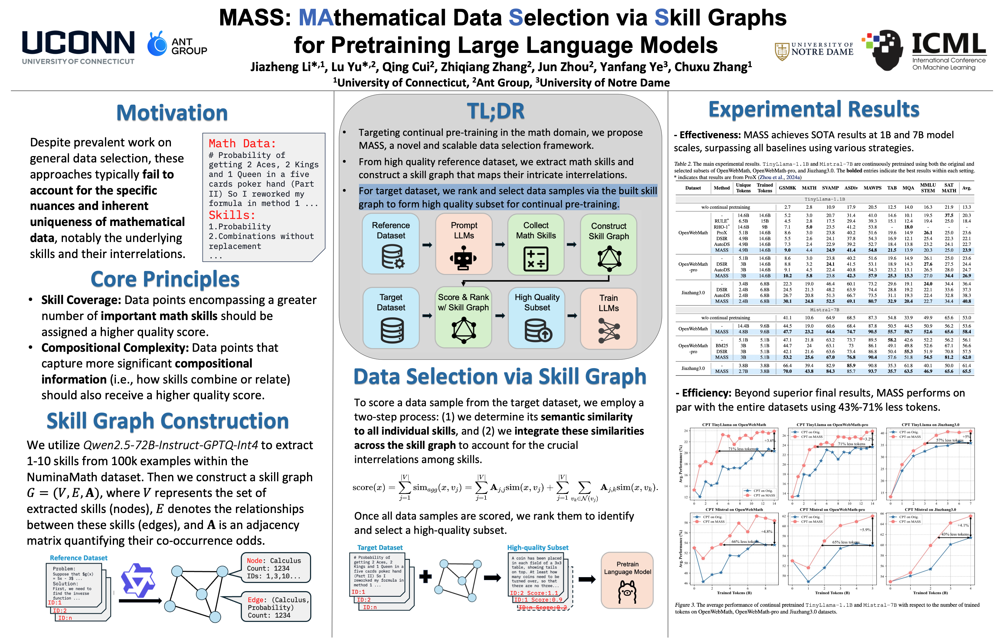

# [ICML 2025] MASS: Mathematical Data Selection via Skill Graphs for Pretraining Large Language Models


<!-- ## Table of Contents
- [\[ICML 2025\] MASS: Mathematical Data Selection via Skill Graphs for Pretraining Large Language Models](#icml-2025-mass-mathematical-data-selection-via-skill-graphs-for-pretraining-large-language-models)
  - [Table of Contents](#table-of-contents)
  - [Overview](#overview)
  - [Installation](#installation)
  - [Project Structure](#project-structure)
  - [Quick Start](#quick-start)
  - [Detailed Usage](#detailed-usage)
    - [Step 1: Extract Skills from Reference Dataset](#step-1-extract-skills-from-reference-dataset)
    - [Step 2: Construct the Skill Graph](#step-2-construct-the-skill-graph)
    - [Step 3: Select High-quality Subset from Target Data](#step-3-select-high-quality-subset-from-target-data)
    - [Step 4: Tokenize the Subset](#step-4-tokenize-the-subset)
    - [Step 5: Start Training](#step-5-start-training)
  - [Expected Outputs](#expected-outputs)
  - [Citation](#citation)
  - [License](#license)
  - [Contact](#contact) -->

## Overview

This is the official GitHub repository for the paper "[MASS: Mathematical Data Selection via Skill Graphs for Pretraining Large Language Models](https://arxiv.org/abs/2503.14917)" published in ICML 2025.

In this work, we target **LLM continual pre-training** in the math domain and propose MASS, a novel and scalable data selection framework.

Our approach consists of two main stages:

1. From a **high-quality reference dataset**, we extract math skills and construct a **skill graph** that maps their intricate interrelations.
2. For a **target dataset**, we rank and select data samples via the built skill graph to form a high-quality subset for continual pre-training.




## Project Structure

```
MASS/
├── skill_extraction.py              # Extract skills from reference dataset
├── construct_skill_graph.ipynb      # Construct skill graph from extracted skills
├── rank_target_data.py              # Rank target data using skill graph
├── tokenize_data_packing.py         # Tokenize selected data for training
├── README.md                        # README
├── LICENSE                          # Apache 2.0 License
├── assets/                          # assets
└── train/
    ├── trainer.py                   # Training script
    ├── train_single_node.sh         # Single-node training script
    ├── train_multi_nodes.sh         # Multi-node training script
    └── ds.json                      # DeepSpeed configuration
```

## Quick Start

Here's a quick example to get you started with MASS:

```bash
# Step 1: Extract skills from reference dataset
python skill_extraction.py \
    --model_name ./Qwen2.5-72B-Instruct-GPTQ-Int4 \
    --data_dir ./numina_100k.jsonl \
    --output_dir ./numina_100k_skills.jsonl

# Step 2: Construct skill graph (follow construct_skill_graph.ipynb)

# Step 3: Rank target data
python rank_target_data.py \
    --reference_embed_path ./numina_100k_content_embed.npy \
    --skill_graph_path ./graph_numina_100k_qwen25_new_adj_1.pkl \
    --target_embed_path ./jiuzhang_embeddings.npy \
    --scores_output_path ./score_jiuzhang_numina100k_newadj_1.pt \
    --target_dataset_path ./jiuzhang3-corpus-pt-cot.jsonl \
    --ranked_dataset_path ./jiuzhang_rerank_numina100k_newadj_1.jsonl

# Step 4: Tokenize data
python tokenize_data_packing.py \
    --tokenizer ./TinyLlama-1.1B-intermediate-step-1431k-3T \
    --dataset ./jiuzhang_rerank_numina100k_newadj_1.jsonl \
    --out-filename ./jiuzhang_rerank_numina100k \
    --max-seq-length 2048 \
    --direction right \
    --add-labels \
    --packing

# Step 5: Train model
cd train
bash train_single_node.sh
```

## Detailed Usage

### Step 1: Extract Skills from Reference Dataset

This step uses a large language model to analyze mathematical questions and identify relevant knowledge points.

```bash
python skill_extraction.py \
    --model_name PATH_TO_LLM \
    --data_dir INPUT_DATASET.jsonl \
    --output_dir OUTPUT_SKILLS.jsonl
```

**Parameters:**
- `--model_name`: Path to the language model 
- `--data_dir`: Path to the reference dataset 
- `--output_dir`: Path to save the labeled reference dataset 

### Step 2: Construct the Skill Graph

Construct the skill graph using the provided Jupyter notebook `construct_skill_graph.ipynb`. This notebook:
1. Loads and embeds skill data
2. Deduplicates knowledge points
3. Constructs a graph based on co-occurrence
4. Processes the graph for further use

Open the notebook in Jupyter and follow the instructions.


### Step 3: Select High-quality Subset from Target Data

Rank and select data samples from the target dataset using the skill graph.

```bash
python rank_target_data.py \
    --reference_embed_path REFERENCE_EMBEDDINGS.npy \
    --skill_graph_path SKILL_GRAPH.pkl \
    --target_embed_path TARGET_EMBEDDINGS.npy \
    --scores_output_path SCORES.pt \
    --target_dataset_path TARGET_DATASET.jsonl \
    --ranked_dataset_path RANKED_DATASET.jsonl
```

**Parameters:**
- `--reference_embed_path`: Path to reference dataset content embeddings.
- `--skill_graph_path`: Path to skill graph pickle file.
- `--target_embed_path`: Path to target dataset embeddings. 
- `--scores_output_path`: Path to save quality scores. 
- `--target_dataset_path`: Path to target dataset. 
- `--ranked_dataset_path`: Path to save ranked target dataset. 

### Step 4: Tokenize the Subset

Tokenize the selected data for training, with optional packing.

```bash
python tokenize_data_packing.py \
    --tokenizer TOKENIZER_PATH \
    --dataset RANKED_DATASET.jsonl \
    --out-filename TOKENIZED_DATASET \
    --max-seq-length MAX_LENGTH \
    --direction PADDING_DIRECTION \
    --add-labels \
    --packing
```

**Parameters:**
- `--tokenizer`: Tokenizer name or path
- `--dataset`: Ranked target dataset path
- `--out-filename`: Output filename 
- `--max-seq-length`: Maximum sequence length 
- `--direction`: Padding direction 
- `--add-labels`: Whether to add loss labels 
- `--packing`: Whether to pack shorter sequences

### Step 5: Start Training

Train the model using the provided training scripts.

Single node training:
```bash
cd train
bash train_single_node.sh
```

Multi node training:
```bash
cd train
bash train_multi_nodes.sh
```

**Training Arguments (in trainer.py):**
- `--model_name`: Path to the pre-trained model
- `--output_dir`: Directory to save model checkpoints and outputs
- `--data_dir`: Directory containing tokenized training data
- `--ratio`: **Data selection ratio** to use for training (0.0 to 1.0)
- `--epochs`: Number of training epochs
- `--save_steps`: Number of steps between checkpoint saves
- `--grad_acc`: Gradient accumulation steps
- `--lr`: Learning rate for training
- `--bs`: Per-device batch size
- `--grad_ckpt`: Enable gradient checkpointing to save memory
- `--use_cache`: Enable model cache for faster inference

## Expected Outputs

After running the complete pipeline, you can expect the following outputs:

1. **Skill Extraction**: A JSONL file containing the reference dataset with extracted knowledge points
2. **Skill Graph**: A PKL file containing the constructed skill graph
3. **Ranked Dataset**: A JSONL file containing the target dataset ranked by relevance
4. **Tokenized Dataset**: A directory containing the tokenized training data
5. **Trained Model**: Model checkpoints saved during training in the specified output directory

## Citation

If you find this work interesting or useful, please consider citing our paper:

```bibtex
@inproceedings{
li2025mass,
title={{MASS}: Mathematical Data Selection via Skill Graphs for Pretraining Large Language Models},
author={Jiazheng Li and Lu Yu and Qing Cui and Zhiqiang Zhang and JUN ZHOU and Yanfang Ye and Chuxu Zhang},
booktitle={Forty-second International Conference on Machine Learning},
year={2025},
}
```

## License

This project is licensed under the Apache License 2.0.

## Contact

For questions, please contact `jiazheng.li@uconn.edu` or open an issue on GitHub.
